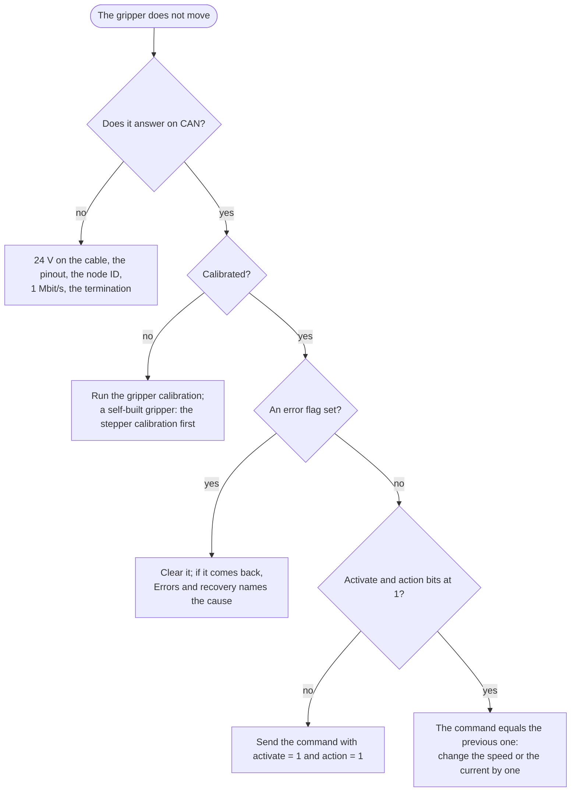

# Troubleshooting

By symptom. The error flags and what clears them are in [Errors and recovery](https://docs.source-robotics.com/MSG-gripper-docs/1.1/06-operation/errors/).

## The gripper does not answer

| Symptom | Check |
|---|---|
| nothing at all | the 24 V on the cable; the cable's pinout (a wrong one has destroyed the driver already); the node ID the host uses; 1 Mbit/s on the adapter; the termination (about 60 Ω across CANH and CANL, unpowered) |
| answers, then stops answering | the watchdog ran out and the host did not notice; a loose M8 connector; a second device with the same node ID |
| the GUI shows *No connection* | the COM port of the CANvas adapter; another program holding the port; the CAN ID in the GUI |

## It does not move

| Symptom | Check |
|---|---|
| calibrated, activated, no error, no motion | the action bit of the command is 0; the command is identical to the previous one (change the speed or the current by one to repeat a move) |
| *Not calibrated* after power-up | normal: run the gripper calibration |
| an error is shown | [Errors and recovery](https://docs.source-robotics.com/MSG-gripper-docs/1.1/06-operation/errors/): clear it, then look at the cause if it comes back |
| the driver reports *Not calibrated* in State_of_Errors and `#Error` | the stepper itself is not calibrated (a self-built gripper): [Driver configuration](https://docs.source-robotics.com/MSG-gripper-docs/1.1/build/first-run/) |

## Calibration

| Symptom | Cause |
|---|---|
| the jaws move to one end and stop; after 24 s the gripper is still not calibrated | the other end is blocked, or the mechanism is too stiff for the calibration's 500 mA: a tight rail, a pinion pressed too hard into the racks, debris in the racks |
| the jaws jitter and do not travel | a phase of the stepper not connected (self-built), or the stepper not calibrated |
| 255 is not fully closed, or 0 not fully open | something stopped the jaws short of the end during calibration; calibrate again with the stroke free |

## The grip

| Symptom | Cause |
|---|---|
| the object slips | the current too low for the object; the jaw faces: sponge tape or the TPU pad |
| the object is crushed | the current too high; a hard object takes the full force at once |
| *object detected* while nothing is there | the current limit too low for the mechanism's friction at that speed; raise the current a little or lower the speed |
| the gripper stops with a temperature error after a while | a long hold at a high current; hold with the lowest current that keeps the object |
| the jaws creep or hum when holding | the position loop against a hard object; lower the current, or hold a soft object with a position slightly beyond the contact |

## Noise and heat

A stepper under field-oriented control is quiet; a grinding noise is the rack and pinion without grease, or
debris. The motor gets warm in use and hot under a long grip; the thermistor stops it at 75 °C. A self-built
gripper without the thermistor on its motor has no such protection.

## After a firmware update

If the gripper does not calibrate or behaves oddly after an update, check the driver's configuration with
`#Info` over UART: gripper mode (`#Gripper 1`), the thermistor (`#Term 1`), the motor calibration. A release note
says when an update clears the configuration; [Driver configuration](https://docs.source-robotics.com/MSG-gripper-docs/1.1/build/first-run/) restores
it.

## Getting help

[Support](https://docs.source-robotics.com/MSG-gripper-docs/1.1/support/) says where to ask and what to include; the gripper's status and `#Info`'s output are
the first things.
