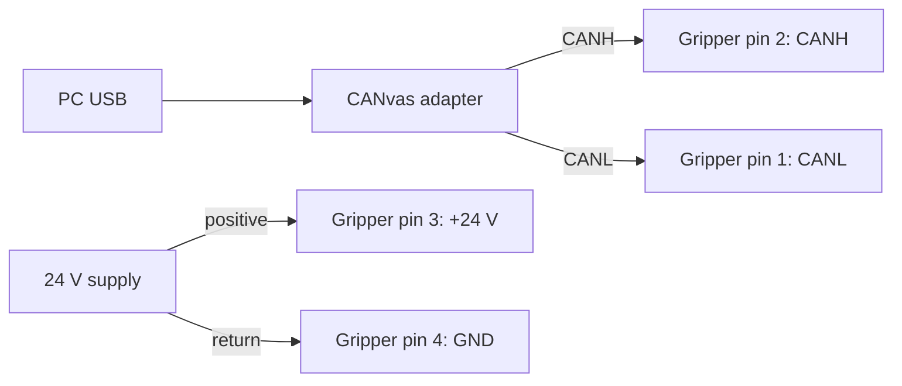

# Quick start

From an assembled MSG gripper to its first gentle open and close, using Motor GUI on a PC.
For a gripper already connected to a robot, use [On PAROL6 and PAR6](https://docs.source-robotics.com/MSG-gripper-docs/1.1/06-operation/robots/).

!!! danger "Before connecting power"
    Keep fingers and loose objects out of the stroke. Calibration opens and closes the jaws fully. A wrong
    cable can put 24 V on the CAN pins and destroy the driver: check the [numbered pinout](https://docs.source-robotics.com/MSG-gripper-docs/1.1/03-technical-data/connector/#pin-numbers).

## 1. Choose your starting point

| Your gripper | Start here |
|---|---|
| Bought assembled | Its stepper is already calibrated and the driver configured. Continue below; the jaws still need calibration after each power-up. |
| Self-built, or a replacement driver or stepper | Finish [Driver setup and first run](https://docs.source-robotics.com/MSG-gripper-docs/1.1/build/first-run/) first, then return here. Do not apply a factory preset to a bought gripper just to try this page. |
| No hardware yet | Open [Motor GUI](https://motorgui.com/), choose **Mock CAN (demo)** and **Connect**, then switch to **Gripper**. The demo is an SSG-48; the control panel is shared with MSG. |

## 2. Gather and mount

You need a mounted gripper with jaws/fingers fitted, a **24 V supply**, a correctly wired **M8 cable**, a
**CANvas USB-to-CAN adapter**, and Chrome or Edge. The [What you need](https://docs.source-robotics.com/MSG-gripper-docs/1.1/01-overview/what-you-need/) page lists
the parts; [Mounting](https://docs.source-robotics.com/MSG-gripper-docs/1.1/04-installation/mounting/) and [Jaws](https://docs.source-robotics.com/MSG-gripper-docs/1.1/04-installation/jaws/) cover the mechanics.

**Check:** the body cannot shift, the jaws travel freely, and the cable cannot enter their path.

## 3. Wire with power off

1. Check the cable against [Connector and pinout](https://docs.source-robotics.com/MSG-gripper-docs/1.1/03-technical-data/connector/): gripper pin 3 is +24 V,
   pin 4 GND, pin 2 CANH, pin 1 CANL. Check continuity before the first power-up.
2. Connect the supply and the CANvas adapter as shown below.
3. Set the gripper's CAN termination ON for this two-node bench bus; the CANvas adapter provides the other end.
   Leave the gripper at its shipped node ID, **0**, unless you already assigned another.

**Check, unpowered:** the supply polarity and cable pinout match, and CANH-to-CANL measures about **60 Ω**
with the bus connected. Otherwise check [The cable](https://docs.source-robotics.com/MSG-gripper-docs/1.1/04-installation/cable/) and
[CAN termination](https://docs.source-robotics.com/MSG-gripper-docs/1.1/04-installation/can-termination/) before powering it.

## 4. Connect Motor GUI

Power the gripper, plug the CANvas adapter into USB, and open [motorgui.com](https://motorgui.com/).
Choose **CAN (slcan)** at **1 Mbit/s**, press **Connect**, and choose the adapter's serial port.
Select node **0** (or your assigned ID) and switch from **Motor** to **Gripper**.

**Check:** position and current feedback arrive. *Not calibrated* after power-up is normal. If feedback is
missing, check the power, port, node ID and termination: [Troubleshooting](https://docs.source-robotics.com/MSG-gripper-docs/1.1/09-troubleshooting/).
If a fault disables the controls, resolve it using [Errors and recovery](https://docs.source-robotics.com/MSG-gripper-docs/1.1/06-operation/errors/).
The [illustrated Motor GUI guide](https://docs.source-robotics.com/MSG-gripper-docs/1.1/05-setup/motor-gui/) shows the panel.

## 5. Calibrate and activate

With the stroke empty and the gripper deactivated, press **Calibrate**, read the prompt, and press
**Start calibration**. Let the jaws find both end stops. Follow [Calibrate, activate, move](https://docs.source-robotics.com/MSG-gripper-docs/1.1/05-setup/first-moves/)
for the full procedure, then **Activate** and check for faults.

**Check:** the panel says **Calibrated**, **Activated**, and **No errors** before you command a move.
A calibration that times out after 24 seconds has not found its end stops; do not continue as if it passed.
Use [Calibration troubleshooting](https://docs.source-robotics.com/MSG-gripper-docs/1.1/09-troubleshooting/#calibration).

## 6. Make the first move

Set **Speed 30** and **Current 300 mA**, applying each with its **Set** button. Press **Open**, then **Close**.
After that works, put a light test object between the jaws and repeat, keeping fingers clear.

**Check:** the position follows the command; on an object the jaws stop before fully closed and the panel reports
an object. If it does not move, slips or reports an error, use [Troubleshooting](https://docs.source-robotics.com/MSG-gripper-docs/1.1/09-troubleshooting/).
The current limit sets an approximate force limit; [Force and speed](https://docs.source-robotics.com/MSG-gripper-docs/1.1/03-technical-data/force-and-speed/)
explains the relationship and the motor's limits.

## 7. Finish and continue

Remove the test object before deactivating or switching off: the grip may release. Disconnect Motor GUI and
switch off the supply before changing cables.

| Next task | Guide |
|---|---|
| Control it from a program | [With Python](https://docs.source-robotics.com/MSG-gripper-docs/1.1/06-operation/python/), [With ROS 2](https://docs.source-robotics.com/MSG-gripper-docs/1.1/06-operation/ros2/) |
| Put it on a robot | [On PAROL6 and PAR6](https://docs.source-robotics.com/MSG-gripper-docs/1.1/06-operation/robots/) |
| Inspect a CAN frame or download DBC definitions | [CAN frame tool and downloads](https://docs.source-robotics.com/MSG-gripper-docs/1.1/reference/can-tools/) |
| Diagnose a problem | [Troubleshooting](https://docs.source-robotics.com/MSG-gripper-docs/1.1/09-troubleshooting/), [Errors and recovery](https://docs.source-robotics.com/MSG-gripper-docs/1.1/06-operation/errors/) |
