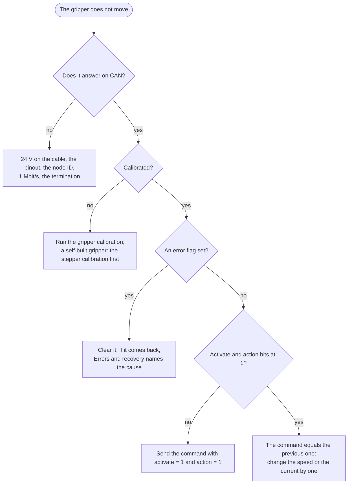

# Troubleshooting

By symptom. The error flags and what clears them are in [Errors and recovery](https://docs.source-robotics.com/MSG-gripper-docs/1.2/06-operation/errors/); the
faults in the firmware and the software that are known and not yet fixed, with what to do until they are, are in
[Known issues](https://docs.source-robotics.com/MSG-gripper-docs/1.2/09-troubleshooting/known-issues/).

## The gripper does not answer

| Symptom | Check |
|---|---|
| nothing at all | the 24 V on the cable; the cable's pinout (a wrong one has destroyed the driver already); the node ID the host uses; 1 Mbit/s on the adapter; the termination (about 60 Ω across CANH and CANL, unpowered) |
| answers, then stops answering | the watchdog ran out and the host did not notice; a loose M8 connector; a second device with the same node ID |
| the GUI shows *No connection* | the COM port of the CANvas adapter; another program holding the port; the CAN ID in the GUI |

## It does not move

| Symptom | Check |
|---|---|
| calibrated, activated, no error, no motion | the action bit of the command is 0; the command is identical to the previous one (change the speed or the current by one to repeat a move) |
| *Not calibrated* after power-up | normal: run the gripper calibration |
| an error is shown | [Errors and recovery](https://docs.source-robotics.com/MSG-gripper-docs/1.2/06-operation/errors/): clear it, then look at the cause if it comes back |
| the driver reports *Not calibrated* in State_of_Errors and `#Error` | the stepper itself is not calibrated (a self-built gripper): [Driver configuration](https://docs.source-robotics.com/MSG-gripper-docs/1.2/build/first-run/) |

## Calibration

| Symptom | Cause |
|---|---|
| the jaws move to one end and stop; after 24 s the gripper is still not calibrated | the other end is blocked, or the mechanism is too stiff for the calibration's 500 mA: a tight rail, a pinion pressed too hard into the racks, debris in the racks |
| the jaws jitter and do not travel | a phase of the stepper not connected (self-built), or the stepper not calibrated |
| the routine ends within a few seconds, and the gripper is still not calibrated | the jaws travelled less than 1000 encoder ticks between the two ends: something jams them |
| 255 is not fully closed, or 0 not fully open | something stopped the jaws short of the end during calibration; calibrate again with the stroke free. By design 0 lies 32 encoder ticks inside the open stop and 255 16 ticks from the closed one (about 0.1 and 0.05 mm at each jaw), so that a full open or close does not press on the stop |

## The grip

| Symptom | Cause |
|---|---|
| the object slips | the current too low for the object; the jaw faces: sponge tape or the TPU pad |
| the object is crushed | the current too high; a hard object takes the full force at once |
| *object detected* while nothing is there | the current limit too low for the mechanism's friction at that speed; raise the current a little or lower the speed |
| the gripper stops with a temperature error after a while | a long hold at a high current; hold with the lowest current that keeps the object |
| the jaws creep or hum when holding | the position loop against a hard object; lower the current, or hold a soft object with a position slightly beyond the contact |
| the current takes a second or more to settle after a move; a full open or close keeps drawing the grip current and reports an object | firmware 109 or older: update to 110 ([Known issues](https://docs.source-robotics.com/MSG-gripper-docs/1.2/09-troubleshooting/known-issues/), KI-11 and KI-12) |

## Noise and heat

A stepper under field-oriented control is quiet; a grinding noise is the rack and pinion without grease, or
debris. The motor gets warm in use and hot under a long grip; the thermistor stops it at 75 °C. A self-built
gripper without the thermistor on its motor has no such protection.

## After a firmware update

The gripper calibration is kept in RAM only: calibrate after an update, as after every power-up. The driver's
settings and its motor calibration are kept from 109 to 110.

If the gripper does not calibrate or behaves oddly after an update, check the driver's configuration over UART:
`#Gripper` (gripper mode, 1), `#Term` (the thermistor, 1) and `#Info` (the motor calibration and parameters). A
release note says when an update clears the configuration; [Driver configuration](https://docs.source-robotics.com/MSG-gripper-docs/1.2/build/first-run/) restores
it.

## Getting help

[Support](https://docs.source-robotics.com/MSG-gripper-docs/1.2/support/) says where to ask and what to include; the gripper's status and `#Info`'s output are
the first things.
