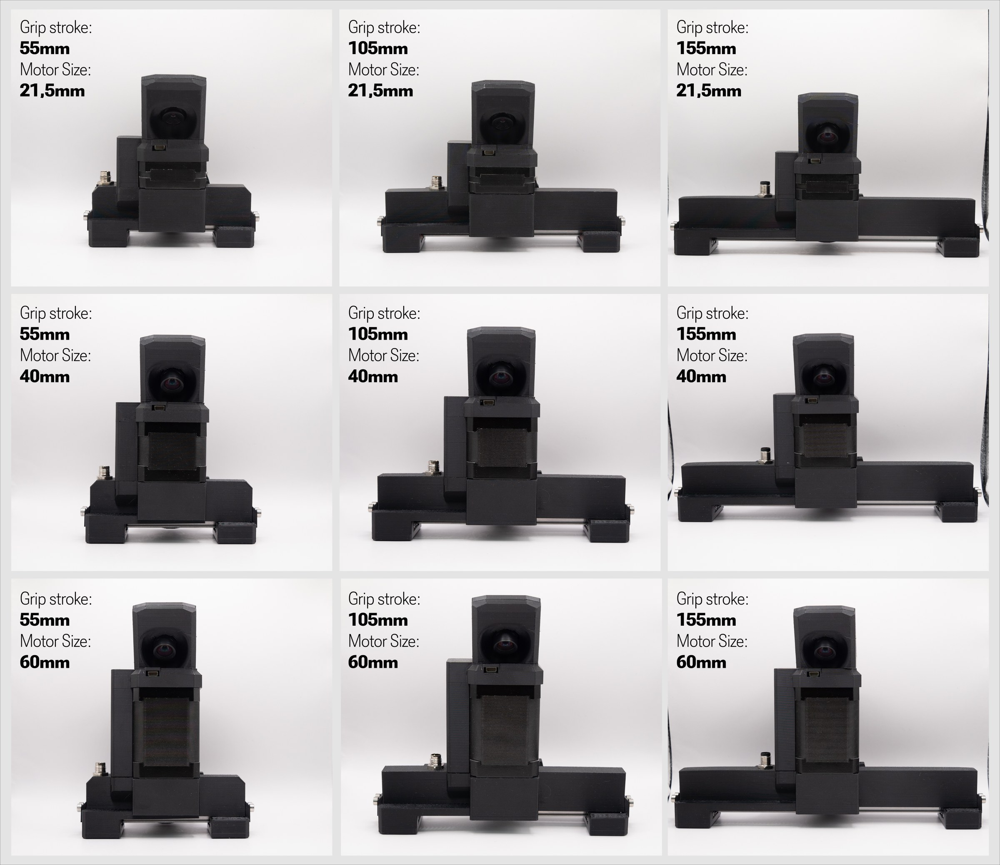
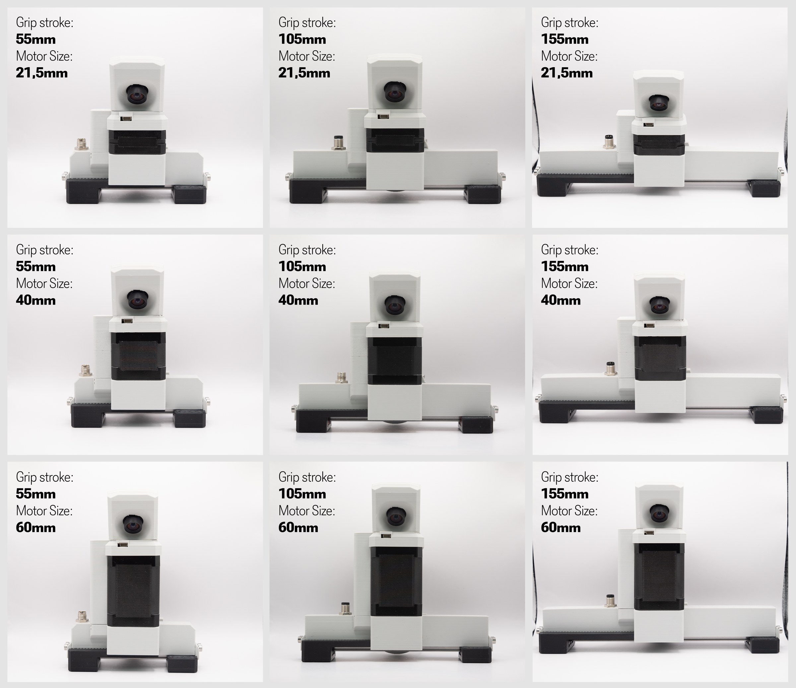

# Build your own

**The MSG is open source, and that is important to us.** Everything the gripper is made of is published in the
[product repository](https://github.com/Source-Robotics/MSG-compliant-AI-stepper-gripper) under the CERN Open
Hardware Licence: the STEP files of every part, the print files, the bill of materials with a link for every item,
the assembly video, and the URDF and MJCF models. The driver's firmware and the software that drives the gripper
are open source too. A gripper you build is the same gripper as the one from the shop, and this manual applies
to it; change the jaws, the camera mount or the body for your application, or fit the gripper to a robot it was
not designed for. This page is the order to do it in.

!!! warning
    A self-built gripper is yours to make safe: the thermistor in the windings, the current within the stepper's
    maximum, and the [Safety](../02-safety.md) chapter apply to it as to a bought one. The gripper is in beta:
    expect rough edges in the hardware and the software.

## 1. Choose the variant

A rail length for the stroke and a stepper length for the force: [Variants](variants.md). The parts to print
depend on both.

=== "Black"
    <figure markdown="span">
      { width="900" }
      <figcaption>Figure 5: The nine combinations of rail and stepper, black body: 55, 105 and 155 mm of stroke across, the 21.5, 40 and 60 mm steppers down.</figcaption>
    </figure>

=== "Grey"
    <figure markdown="span">
      { width="900" }
      <figcaption>The same nine combinations, grey body.</figcaption>
    </figure>

## 2. Print the parts

| Variant | Folders in [STEP files](https://github.com/Source-Robotics/MSG-compliant-AI-stepper-gripper/tree/main/STEP%20files) |
|---|---|
| every gripper | `Common parts`: the coupler plate and ring cover (or `ring_cover-PAROL6`), the camera mount and lid, the jaw blocker, the stepper spacer, the connector lid |
| your rail | `Linear rail dependant parts/<rail>`: the body and the two jaw carriers |
| your stepper | `Stepper dependant parts/<stepper>`: the stepper cover, and the spacer for the 21.5 mm stepper |
| the jaws | `Gripper jaws attachment`: one of the designs, mirrored for the other side ([Jaws](../04-installation/jaws.md)) |

The [Print files](https://github.com/Source-Robotics/MSG-compliant-AI-stepper-gripper/tree/main/Print%20files)
folder has the same parts as 3MF, ready to slice. PETG, 25 % infill for everything; TPU for the jaw pads.

## 3. Source the rest

The [BOM](https://github.com/Source-Robotics/MSG-compliant-AI-stepper-gripper/blob/main/BOM.md) lists every
part with a link: the stepper of your variant, the STEPFOC driver, the encoder magnet, the thermistor and the
thermal cement, the MGN7 rail and two carriages, the pinion (32 DP, 21 teeth, 5 mm bore), the shaft coupler, the
M8 connector and the short XH and ZH cables that connect the driver inside, the brass inserts and the screws, the
camera, and the sponge tape for the jaws. The screws for the stepper depend on its length (22, 40 or 60 mm M3).

## 4. Configure the driver

Before the pinion goes in: mount the driver on the stepper with its magnet, calibrate the motor, set up gripper
mode and the thermistor, and save. [Driver configuration](../05-setup/driver-configuration.md) is the procedure;
the magnet and the driver's mounting are in the
[STEPFOC documentation](https://docs.source-robotics.com/STEPFOC-docs/latest/04-mounting/). Place the thermistor
bead in the windings with thermal cement and route its leads to the driver's thermistor connector.

## 5. Assemble

Follow the [assembly video](https://youtu.be/oAUhDKYgLso). The rail with its two carriages goes into the body,
the racks onto the carriages, the stepper with the pinion into the body so that the pinion meshes with both
racks, the driver's power and CAN cables to the M8 connector in its lid, the stepper cover over the driver with the
termination switch reachable through its opening, the coupler plate with the shaft coupler on the back, and the
jaws on the carriers.

## 6. Cable, calibrate, move

An M8 4-pin cable to your robot or your supply and CAN adapter: [The cable](../04-installation/cable.md) has the
wiring diagrams and the warning about the two robots' cables. Power up, calibrate the gripper, activate it and
move it at a low current, as in [Calibrate, activate, move](../05-setup/first-moves.md). If the calibration does
not find both end stops, the mechanism is too stiff: loosen the rail, check the pinion's depth in the racks,
grease.
