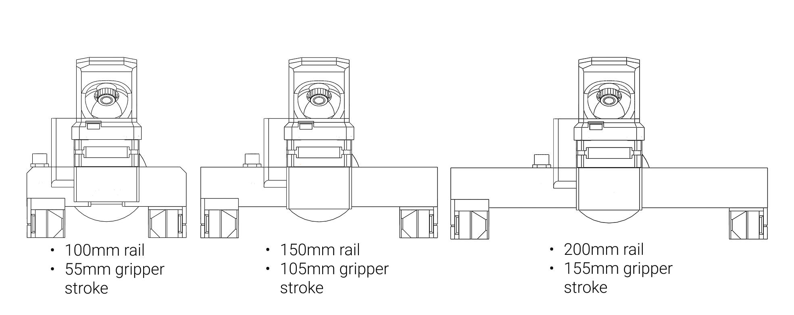

# Variants

The gripper is modular in two ways: the length of the linear rail sets the stroke, the length of the stepper sets
the force. Any rail goes with any stepper; the body, the jaws and the stepper cover are printed for the chosen
combination.

<figure markdown="span">
  { width="900" }
  <figcaption>Figure 2: The three rail lengths and the stroke each gives.</figcaption>
</figure>

## Rail length and stroke

| Rail | Stroke | Printed parts |
|---|---|---|
| 100 mm | 55 mm | `MSG_Gripper_body_100mm`, `gripper_jaw_100mm_L/R` |
| 150 mm | 105 mm | `MSG_Gripper_body_150mm`, `gripper_jaw_150mm_L/R` |
| 200 mm | 155 mm | `MSG_Gripper_body_200mm`, `gripper_jaw_200mm_L/R` |

The stroke is the distance between the jaw carriers from fully open to fully closed; the opening between the
jaw faces depends on the jaws you fit ([Jaws](../04-installation/jaws.md)). A longer rail makes the gripper wider
and a little heavier and does not change the force.

<figure markdown="span">
  { width="520" }
  <figcaption>Figure 3: The 150 mm rail: 105 mm of stroke.</figcaption>
</figure>

## Stepper length and force

| Stepper | Motor | Rated current | Holding torque | Printed parts |
|---|---|---|---|---|
| 21.5 mm | 17HS08-1004S | 1.0 A | 16 Ncm | `Stepper_cover_21_5mm`, `Stepper_spacer_21_5` |
| 40 mm | 17HS16-2004S1 | 2.0 A | 45 Ncm | `Stepper_cover_40mm` |
| 60 mm | 17HS24-2104S | 2.1 A | 65 Ncm | `Stepper_cover_60mm` |

A longer stepper gives more torque and so more grip force, at the price of weight and length behind the
gripper. The force the current produces, and what each stepper can do, is in
[Force and speed](../03-technical-data/force-and-speed.md). The current limit you command must stay within the
stepper's rating.

## Grasps

The gripper grips from the outside (the jaws close on the object) and from the inside (the jaws open inside a
hollow object). Both are the same move command with a different target; object detection reports *while closing*
for the first and *while opening* for the second.

## The camera

The camera mount on top of the body carries an OV9732 USB camera module (100° version in the BOM), looking down
between the jaws. It is a plain USB camera with its own cable, independent of the gripper's electronics; the mount
and its lid are printed parts (`camera extension`, `camera_lid`), and a gripper without a camera simply leaves
them off.

<figure markdown="span">
  { width="700" }
  <figcaption>Figure 4: The gripper on a PAROL6 and what its camera sees.</figcaption>
</figure>
