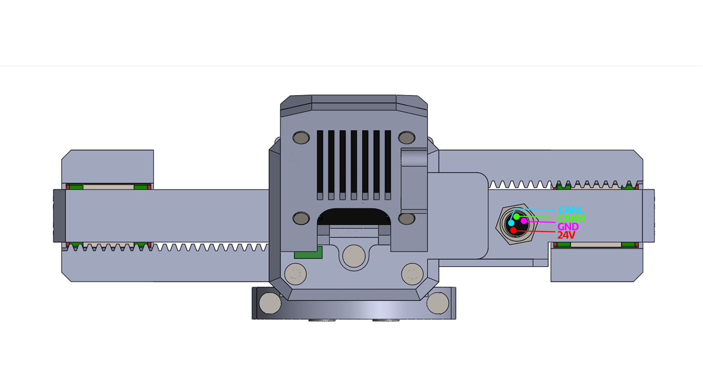

# Connector and pinout

The gripper has one connector, an M8 4-pin male on the side of the body, and one cable: 24 V and the CAN bus.

<figure markdown="span">
  { width="900" }
  <figcaption>Figure 5: The M8 connector on the gripper body and its four signals: 24V, GND, CANH, CANL.</figcaption>
</figure>

| Signal | What it is |
|---|---|
| 24V | the supply, 24 V DC |
| GND | the supply's return and the CAN bus reference |
| CANH, CANL | the CAN bus, 1 Mbit/s |

Which pin of the M8 carries which signal is shown in Figure 5. The cables for PAROL6 and PAR6 are wired
differently at the robot end; [The cable](../04-installation/cable.md) has the wiring diagram of each.

!!! danger "The wrong cable destroys the driver"
    A cable with 24 V on a CAN pin destroys the driver inside the gripper the moment it is powered. Use the cable
    made for your robot; check a self-made cable pin by pin against Figure 5 and the wiring diagram before you
    plug it in.

## Inside the housing

The STEPFOC driver's own connectors are inside: its UART port (3.3 V, JST SH, 4 pins) under the coupler plate,
used to configure a self-built gripper ([Over UART](../06-operation/uart.md)), and its CAN termination switch,
reachable through an opening in the stepper cover ([CAN termination](../04-installation/can-termination.md)). The
driver's pinout is in the [STEPFOC documentation](https://docs.source-robotics.com/STEPFOC-docs/latest/03-technical-data/connectors/).
