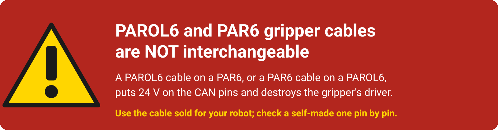
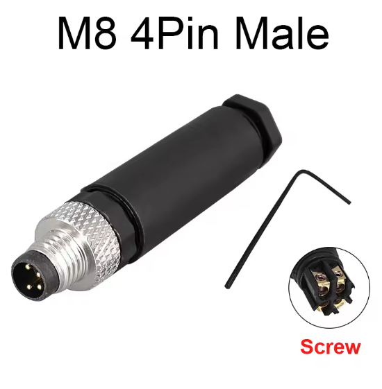
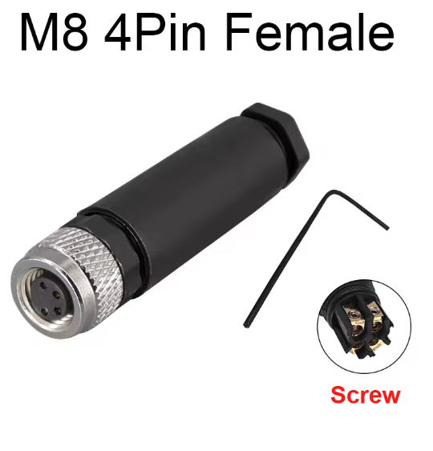
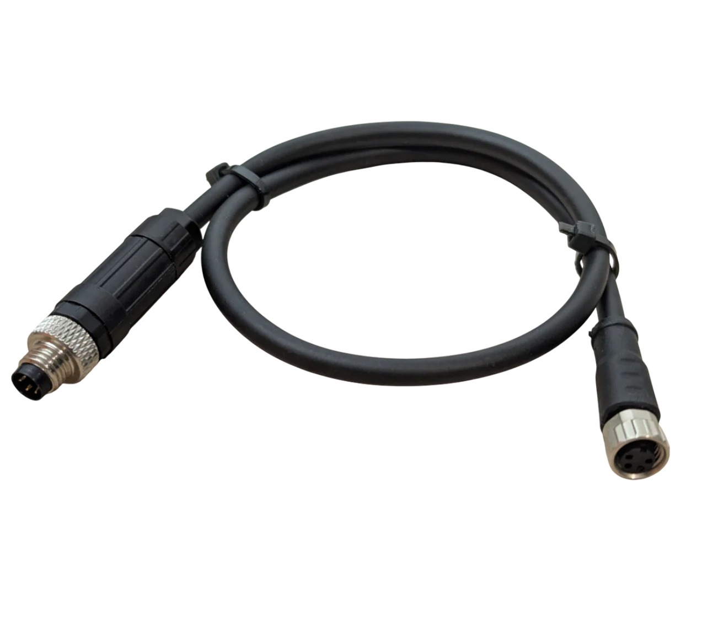
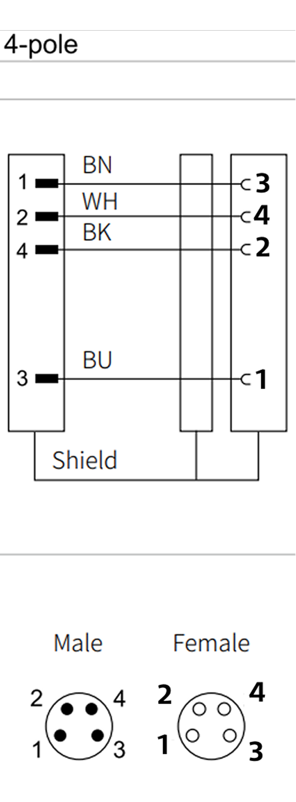
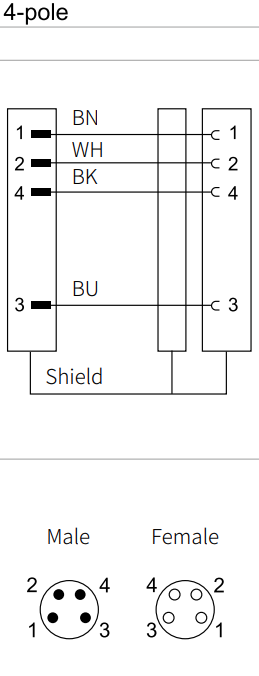

# The cable

{ width="1000" }

One cable with an M8 4-pin connector powers the gripper and carries its CAN bus. The robot end differs from robot
to robot.

!!! danger "PAROL6 and PAR6 cables are different"
    The two robots put the four signals on different pins of their gripper port. The PAROL6 cable in a PAR6, or
    the other way round, puts 24 V on the CAN bus and destroys the gripper's driver. Use the cable sold for your
    robot, and check a self-made cable pin by pin.

## The cables from the shop

| Robot | Cable |
|---|---|
| PAROL6 | [PAROL6 gripper cable](https://source-robotics.com/products/gripper-cable) |
| PAR6 | the PAR6 gripper cable, coming to the shop |

## Making your own

For a bench setup, another robot, or a replacement, the cable is four wires between an M8 4-pin female connector
at the gripper and whatever the other end needs:

| Part | Quantity | BOM |
|---|---|---|
| 26 AWG 4-wire twisted-pair cable, 0.15 mm², shielded | about 0.4 m | [cable](https://s.click.aliexpress.com/e/_c4m3ggwn) |
| M8 4-pin female cable connector (the gripper has the male) | 1 | [connector](https://s.click.aliexpress.com/e/_c4OWHPKF) |
| M8 4-pin male cable connector, for a robot with an M8 port | 1 | the same listing |

{ width="260" }
{ width="260" }
{ width="340" }

Wire it as the diagram for your robot shows. Pin 1 to 4 are the numbers moulded into the M8 connectors; the
colours are those of the cable in the BOM.

=== "PAROL6"
    <figure markdown="span">
      { width="320" }
      <figcaption>Figure 11: The PAROL6 cable: the pins are crossed between the two ends.</figcaption>
    </figure>

=== "PAR6"
    <figure markdown="span">
      { width="200" }
      <figcaption>Figure 12: The PAR6 cable: pin to pin.</figcaption>
    </figure>

=== "Bench or your own robot"
    Connect the gripper's 24V and GND to a 24 V supply and its CANH and CANL to your CAN interface; on a PC that
    is the CANvas adapter's CAN terminals. [Connector and pinout](../03-technical-data/connector.md) shows which
    pin of the gripper's connector is which signal. Twist the CAN pair, keep the cable short at 1 Mbit/s, and
    terminate the bus at both ends ([CAN termination](can-termination.md)).

Connect the shield at one end only. Check continuity and the absence of shorts between all four pins before the
first power-up.

## Handling

Plug and unplug with the supply off. Route the cable along the robot with enough slack for the wrist's full
motion, and keep it away from the jaws' travel.
