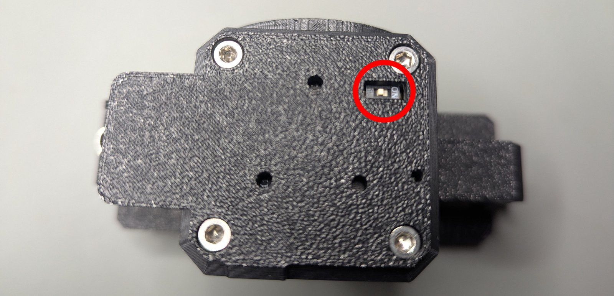

# CAN termination

A CAN bus needs a 120 Ω resistor at each of its two ends. The gripper's driver has one, on a switch that is
reachable through an opening in the stepper cover: **ON** connects the resistor, **1** disconnects it.

<figure markdown="span">
  { width="700" }
  <figcaption>Figure 15: The termination switch of the driver, seen through the stepper cover.</figcaption>
</figure>

| The gripper is | Switch |
|---|---|
| the last node on a robot's bus, at the end of the arm | ON |
| alone on a bench bus with the CANvas adapter (which has its own termination) | ON |
| in the middle of a bus, with other nodes after it | 1 (off) |

A bus with the right termination measures about 60 Ω between CANH and CANL with everything unpowered. A missing
or doubled termination shows up as lost frames and a gripper that answers only sometimes.
