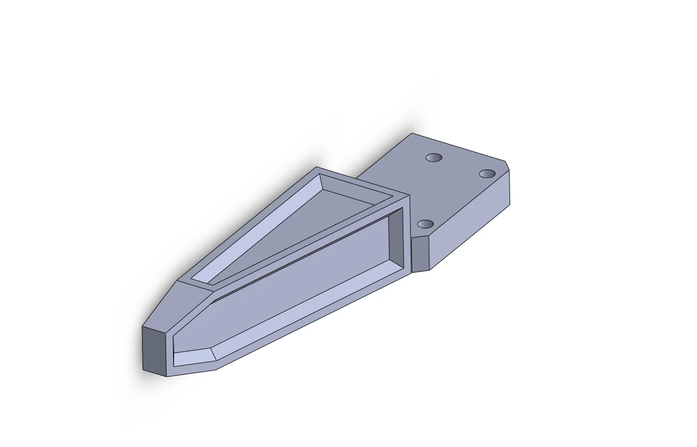
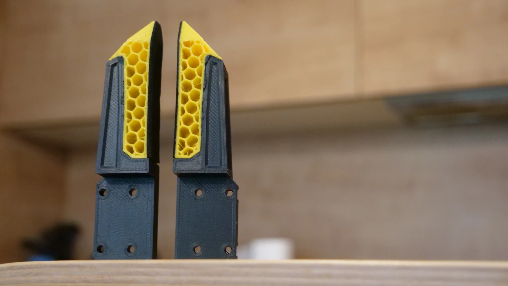
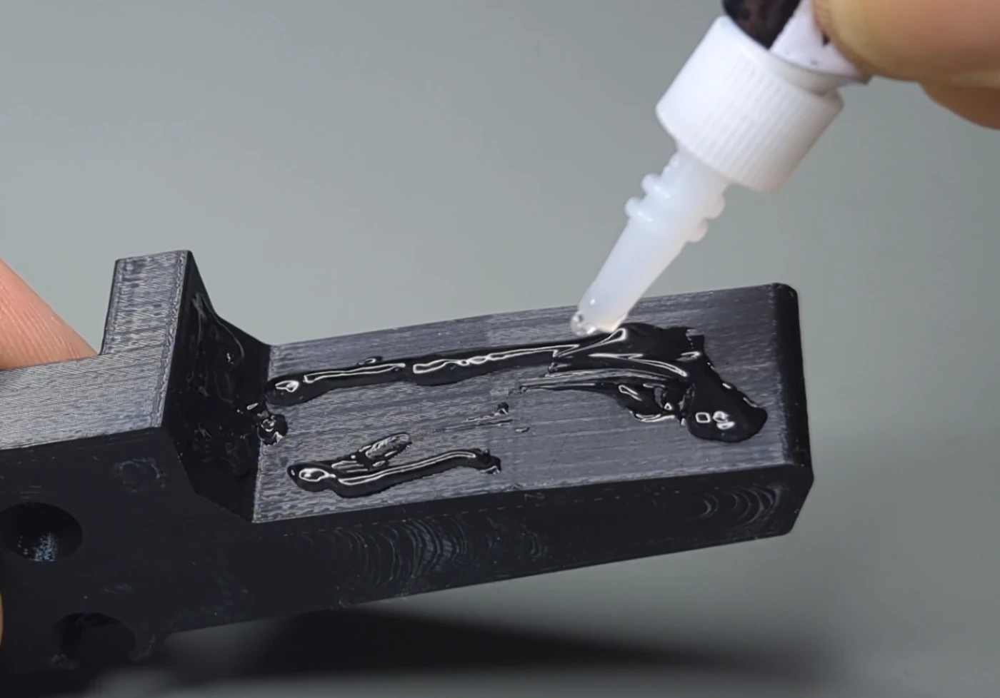
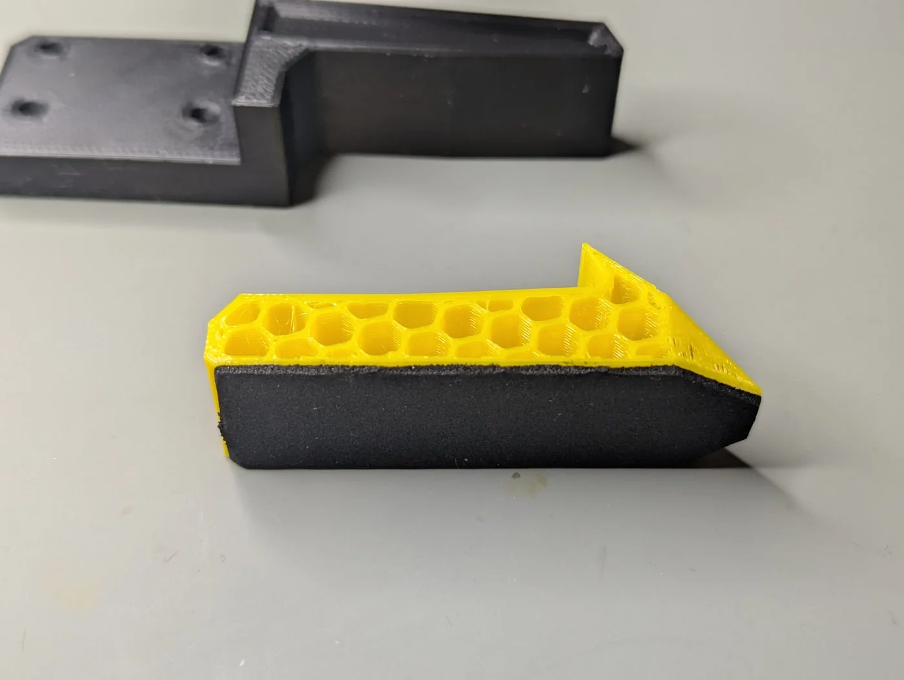
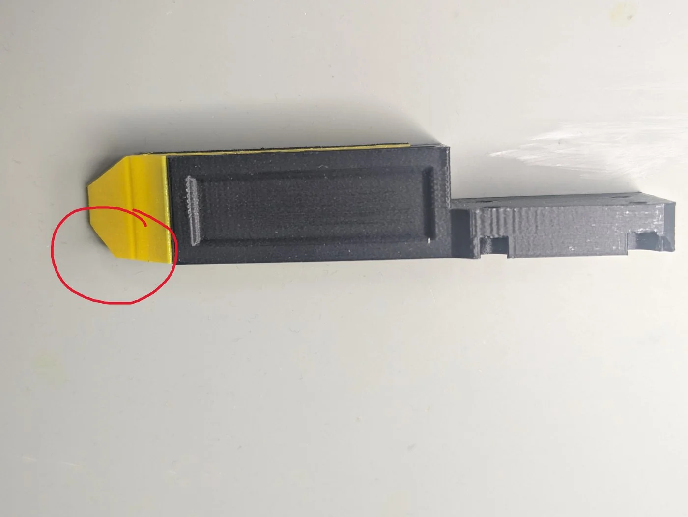

# Jaws

The jaws bolt to the two carriers on the rail and are yours to adapt. The product repository has three designs,
all in [Gripper jaws attachment](https://github.com/Source-Robotics/MSG-compliant-AI-stepper-gripper/tree/main/STEP%20files/Gripper%20jaws%20attachment);
each file is one jaw, mirrored in the slicer for the other side.

| Design | File | Use |
|---|---|---|
| PETG body with a glued-on TPU pad | `MSG_JAW_TPU_GLUE` | the recommended jaw: the soft pad deforms around the object and holds it better |
| Solid jaw | `MSG_solid_jaw`, `MSG_solid_jaw_mirror` | one part, quick to print |
| Hollow jaw | `MSG_JAW_HOLLOW` | lighter, and suited to multi-colour prints |

<figure markdown="span">
  { width="520" }
  <figcaption>Figure 12: The jaw body, with the mounting holes for the carrier.</figcaption>
</figure>

## The TPU jaw

<figure markdown="span">
  { width="700" }
  <figcaption>Figure 13: The TPU jaw: a PETG body (orange) and a TPU pad (green).</figcaption>
</figure>

Print the body in PETG with your usual settings and the pad in TPU with 16 % infill, no top or bottom layers and
two walls, for the softest pad. Then glue the pad to the body with ordinary super glue, in the orientation the
pictures show: a pad glued the wrong way round leaves the jaws facing the wrong direction.

{ width="300" }
{ width="300" }
{ width="300" }

## Sponge pads

A strip of 1 mm sponge tape (30 mm wide, in the BOM) on the gripping face of any jaw improves the hold on hard
and smooth objects a great deal. Cut it to length, peel the backing and press it on.

## Your own jaws

Keep the carrier's hole pattern from one of the designs and shape the rest for your objects. Long jaws
multiply the lever arm on the carriers: keep them short and stiff, and remember that the grip force is set at the
jaw faces, not at the rail.

## Calibrate after changing the jaws

The gripper calibration finds the end stops with the jaws fitted; jaws that meet earlier or later than the old
ones change where 255 is. Calibrate again after a change, which happens at the next power-up anyway.
