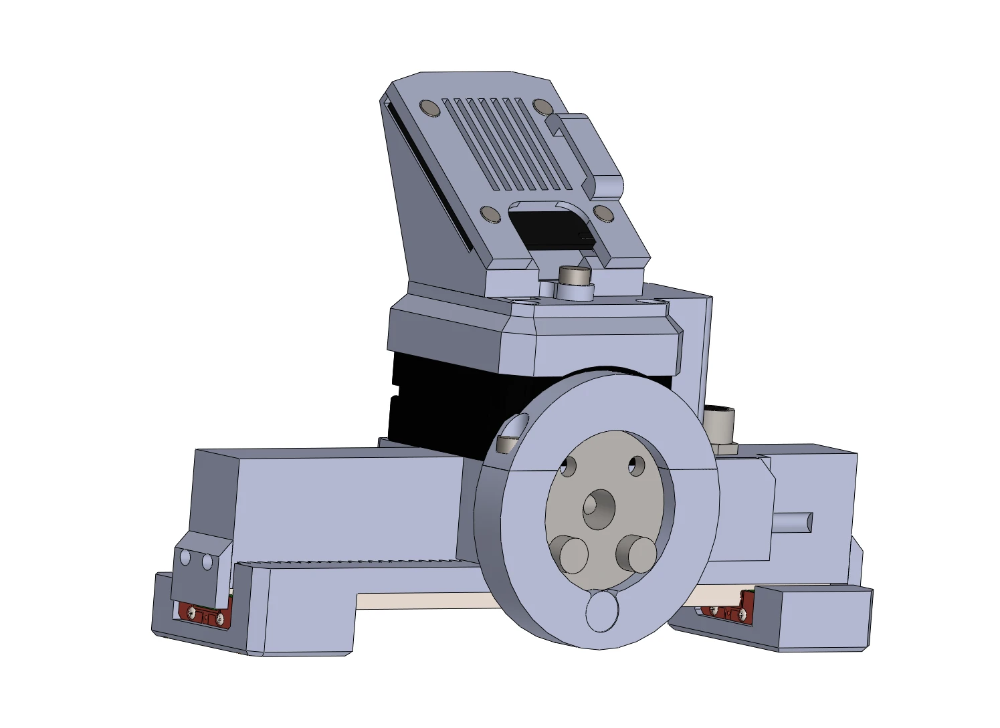
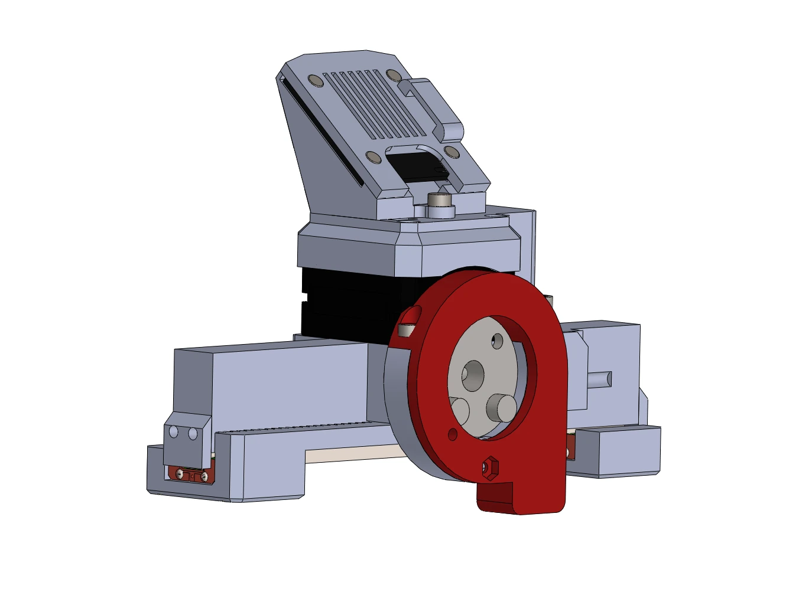

# Mounting on a robot

The gripper mounts by its coupler plate, the round plate on the back of the body behind the stepper. Two covers
exist for it, and the STEP files let you make a third.

## An 8 mm shaft

As shipped, the coupler plate carries a shaft coupler with an 8 mm bore and M4 clamp screws under the `ring_cover`
part: the gripper slides onto an 8 mm shaft and is clamped with the two M4 screws. Any robot or fixture that
offers an 8 mm shaft takes the gripper this way.

<figure markdown="span">
  { width="600" }
  <figcaption>Figure 8: The coupler plate with the 8 mm shaft coupler.</figcaption>
</figure>

## PAROL6

For the PAROL6 wrist, replace `ring_cover` with `ring_cover-PAROL6` from the STEP files (`Common parts`): it bolts
to the robot's last joint. The PAROL6 gripper cable then runs from the gripper to the robot's gripper port; see
[The cable](cable.md) and [On PAROL6 and PAR6](../06-operation/robots.md).

<figure markdown="span">
  { width="600" }
  <figcaption>Figure 9: The gripper with the PAROL6 ring cover (red).</figcaption>
</figure>

## Another robot

Adapt `ring_cover`, or the body itself, to your flange: the STEP files are open. Keep the gripper's connector
reachable and the camera's view free, and route the cable so that it cannot be pulled by the robot's motion.

## On the bench

For testing, clamp the body, not the jaws or the rail, and leave the whole stroke free: calibration moves the
jaws from one end stop to the other without any command from you.
