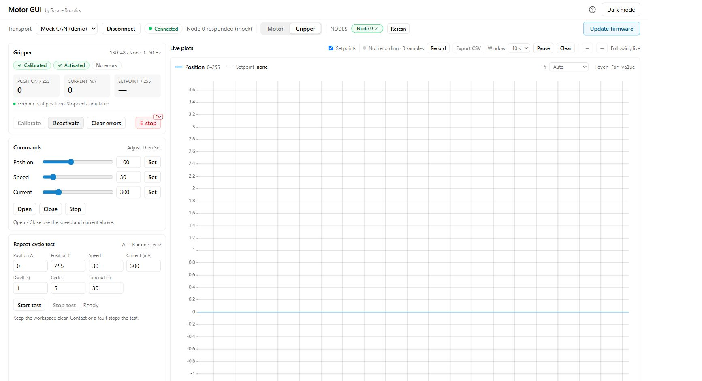
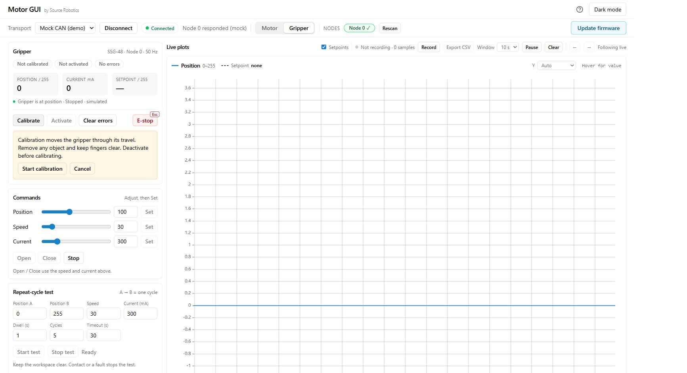

# Motor GUI

[Motor GUI](https://motorgui.com/) is Source Robotics' tool for its drivers and for the grippers built on them: a
page in the browser that reaches the hardware through the browser's serial port access, so there is nothing to
install. With the CANvas adapter on the gripper's CAN bus it calibrates and activates the gripper, opens and closes
it, shows its state and plots its position and current. It is the recommended tool for the first setup and for
testing; everything it does is one CAN message, so what you learn here carries over to
[Python](../06-operation/python.md) and the other interfaces.

!!! note "The gripper GUI is legacy"
    The earlier [SSG-gripper-GUI](https://github.com/Source-Robotics/SSG-gripper-GUI), a Python program with a
    Windows build, still works with both grippers but is not developed further. Use Motor GUI.

## What you need

- A Chromium-based browser: Chrome, Edge, Brave or Opera. The serial port access Motor GUI relies on (Web Serial)
  is not in Firefox or Safari.
- The [CANvas adapter](https://source-robotics.com/products/canvas-usb-to-can-adapter) in a USB port and on the
  gripper's CAN bus, with the bus terminated ([CAN termination](../04-installation/can-termination.md)), and the
  gripper powered.
- Nothing on the gripper itself: a bought gripper is ready. The browser's port access and the adapter's
  installation are described on the STEPFOC site, [Motor GUI](https://docs.source-robotics.com/STEPFOC-docs/latest/05-setup/motor-gui/).

## Connecting

1. Open [motorgui.com](https://motorgui.com/). In the connection bar choose **CAN (slcan)** and the bitrate
   1 Mbit/s, then connect: the browser asks which serial port, pick the CANvas adapter.
2. Choose the gripper's node in the node picker: its CAN ID, 0 unless you changed it. Switch the bar from
   **Motor** to **Gripper**.
3. The gripper panel fills in as soon as the gripper's feedback arrives: calibrated or not, activated or not, the
   position, the current and the errors. While it says that it is waiting for feedback, check the node ID, the
   power and that the driver is in gripper mode.

The panel works with one gripper at a time; to work with another on the same bus, pick its node. The **Motor**
side of the switch shows the same driver as a motor, which the gripper does not need.

## Try it without a gripper

Open [Motor GUI](https://motorgui.com/), choose **Mock CAN (demo)** and **Connect**, then switch to **Gripper**.
The whole panel runs in the browser without an adapter or a gripper. The mock device identifies itself as
SSG-48; MSG uses the same controls.

## The gripper panel

<figure class="gui-shot" markdown="1">

{ width="1000" }

1
2
3

<figcaption markdown="1">**1. State:** calibrated, activated, and no errors. **2. Commands:** position, speed and current, each applied with its Set button. **3. Plots:** position and current feedback. Captured from the **SSG-48 mock demo**; MSG uses the same controls.</figcaption>
</figure>

| Control | What it does |
|---|---|
| **Calibrate** | runs the gripper calibration: the jaws travel the whole stroke to find the end stops. The panel asks you to confirm; deactivate the gripper and take everything out of the jaws first |
| **Activate**, **Deactivate** | the activate bit: a calibrated gripper carries out moves only while it is activated |
| *Position*, *Speed*, *Current*, each with **Set** | the move: position 0 (open) to 255 (closed), speed 0 to 255, current limit 0 to 1500 mA, which is the force. Each **Set** sends its value together with the other two as last sent |
| **Open**, **Close** | a move to position 0 or 255 with the set speed and current |
| **Stop** | ends the move where the jaws are |
| **E-stop**, or ++esc++ | stops the gripper at once: the move command with the E-stop bit, after which the gripper reports the E-stop error until it is cleared |
| **Clear errors** | clears the errors; an error whose cause remains comes straight back |
| Plots | position and current, live, with the requested position drawn in; the window and the scale are adjustable, and **Export CSV** saves a recorded run |
| Events | the feedback rate and the recent gripper events, with **Export events** for diagnostics |
| Cycle test | moves between two positions at a speed and a current, a number of times with a dwell: for endurance tests and demonstrations. Keep the tab visible while it runs |

Motor GUI's current limit stops at 1500 mA. The 40 mm and 60 mm steppers take more
([Force and speed](../03-technical-data/force-and-speed.md)); for their full force, command the move from
Python or over CAN.

## Presets for a self-built gripper

Connected over **UART** instead, through the [serial adapter](https://source-robotics.com/products/usb-to-serial-adapter)
on the driver's UART port, Motor GUI's setup page has tuned presets for the grippers: *MSG 21.5 mm motor*, *MSG 40 mm
motor* and *MSG 60 mm motor*, and *SSG-48* for the other gripper. A preset writes the
motor's parameters, the loop gains, gripper mode, the thermistor and the CAN ID to the driver and saves them; its
CAN ID is 6, the PAR6 gripper's, so change it before applying for another robot.
[Driver configuration](../build/first-run.md) says when to apply it, and lists the same settings as commands
for a terminal.

## Calibration prompt

<figure class="gui-shot" markdown="1">

{ width="1000" }

1
2
3

<figcaption markdown="1">**1. Gripper view:** select the intended node and Gripper panel. **2. Calibration prompt:** clear the stroke and confirm only when ready. **3. State:** wait for Calibrated before moving. This is the SSG-48 simulation; it is not a measurement of calibration time.</figcaption>
</figure>

## What next

[Calibrate, activate, move](first-moves.md) is the first session with a connected gripper.
