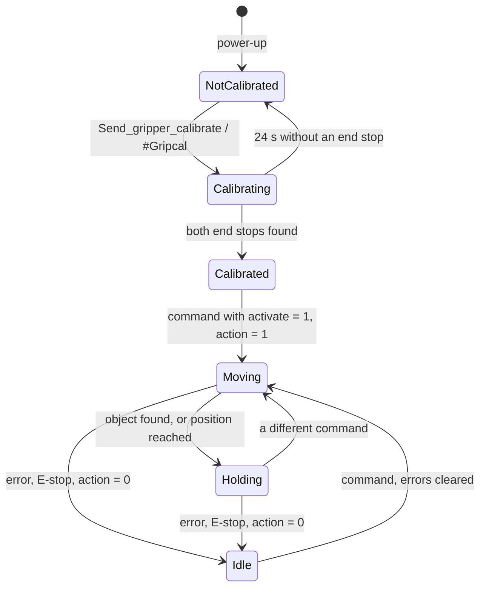
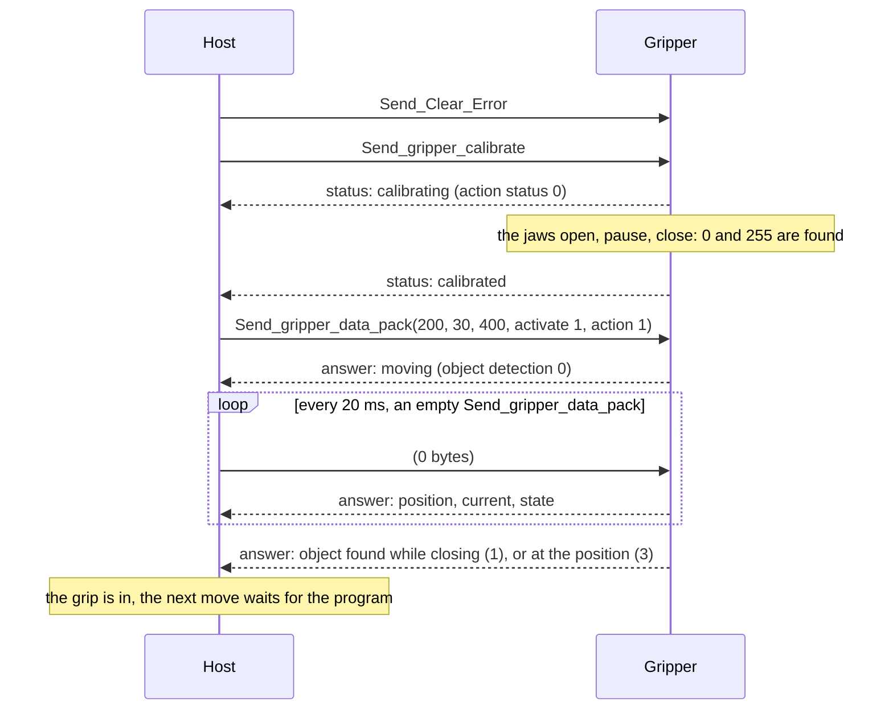

# How the gripper works

The gripper is a state machine in the driver's firmware, fed by one command and answering with one status. This
page is what it does with them.

## The states

**Not calibrated.** After power-up the gripper does not know where its jaws are. It answers status requests and
refuses moves. The gripper calibration is not kept over a power cycle.

**Calibrating.** The jaws open at speed 40 and 500 mA until they have stood still against the end stop for half a
second, pause briefly, then close the same way. The two positions become 0 and 255. If an end stop is not found
within 24 seconds, the routine gives up and the gripper stays uncalibrated. Nothing else is accepted while it
runs; the action bit of the status reads 0.

**Moving.** A command with the activate and action bits set starts a move towards the position, at the speed,
with the current limited to the commanded value. The driver runs its velocity loop towards the target and watches
two things: the speed of the jaws and the motor current.

**Holding.** The move ends in one of two ways. The jaws reach the target (within 5 encoder ticks) and the driver
switches to position control and holds it there: object detection reads 3. Or the jaws stop before the target
with the current at its limit: an object is in the way, and the driver keeps pushing with the limited current,
which is the grip. Object detection reads 1 if the jaws were closing, 2 if they were opening. Nothing moves until
a different command arrives.

**Idle.** An error, the E-stop bit, or a command with the action bit at 0 takes the gripper to idle: the motor is
no longer driven and holds nothing beyond the mechanism's friction, so an object can slip. Clearing the error, or
the next command with the action bit set, moves it again.

## The command

Send_gripper_data_pack carries, in 5 bytes:

| Field | Range | Meaning |
|---|---|---|
| Position | 0 to 255 | 0 fully open, 255 fully closed, linear over the stroke |
| Speed | 0 to 255 | 500 to 60000 encoder ticks per second, see [Force and speed](../03-technical-data/force-and-speed.md) |
| Current | mA | the current limit of the move, so the grip force; not clamped by the firmware |
| Activate | bit | 1 activates the gripper; 0 deactivates it, and it stops |
| Action | bit | 1 carries out the move; 0 stores the command and leaves the gripper idle |
| E-stop | bit | 1 stops the gripper and raises the E-stop error |
| Release direction | bit | read by the firmware but not used |

The same command sent twice does nothing new: the driver compares every command with the previous one, and only
a changed command resets the "at position" state and starts a move. So a host may repeat the command at any
rate, which the CAN watchdog needs; to move the jaws from a held position to the same position again, change
the speed or the current by one.

An empty Send_gripper_data_pack, 0 bytes, changes nothing and is answered like a full one: it is the status poll,
and it costs the bus almost nothing. A host usually sends one full command per move and polls with empty ones.

Over UART, `#Grippos` is the same command: it sets the position, activates the gripper, sets the action bit and
starts the move, with the speed and current last set by `#Gripvel` and `#Gripcur` (50 and 400 mA after power-up).

## The answer

Every Send_gripper_data_pack is answered with Respond_Gripper_data_pack, 4 bytes:

| Field | Meaning |
|---|---|
| Position | where the jaws are, 0 to 255 |
| Current | the motor current, mA; positive while opening, negative while closing |
| Activated | the activate flag |
| Action status | 1 while a move is in progress, 0 when idle, holding, or calibrating |
| Object detection | 0 moving, 1 object found while closing, 2 object found while opening, 3 at the position |
| Temperature error | the motor's thermistor is above the limit |
| Timeout error | the driver's CAN watchdog ran out |
| E-stop error | the E-stop bit was received |
| Calibrated | the gripper calibration is done |

The bits are listed in [Errors and status bits](../reference/errors.md), with the byte layout in the
[CAN reference](../reference/can/gripper.md).

## A grip, message by message

What a host sends and what comes back, from power-up to a held object:

## Object detection, exactly

While a move is in progress and the jaws are not yet at the target, the driver reads *moving* (0) as long as the
jaws move faster than 500 encoder ticks per second, about 1.6 mm/s. When they are slower than that and the motor
current is above 80 % of the commanded limit, something stops them: *object found*, 1 or 2 by the sign of the
current. Below 80 % with the jaws slow, it still reads *moving*: the jaws are accelerating or the object is soft
and still being squeezed. Once the target is reached, 3, and it stays 3 until a different command arrives.

The state is therefore a snapshot of each answer. A host that wants to know "did the grip succeed" sends the move,
then polls until the state is 1, 2 or 3, with a timeout of its own; the ROS 2 driver and the PAROL6 software do
exactly that.

## What the current limit does

The current limit of a move is the driver's Iq limit for the duration of the move and the hold. It bounds the
torque, so the force on an object, and it also bounds how fast the jaws accelerate: a low limit with a high speed
gives a gentle, slow-starting move. The temperature of the motor is the other bound: holding an object at a high
current for minutes heats the windings, and at 75 °C the thermistor stops the gripper.

## Timing

The driver runs its loops at 6250 Hz; a move command takes effect at the next cycle, and the answer leaves within
a millisecond. The CAN bus at 1 Mbit/s carries a command and its answer in well under half a millisecond, so a host
can run the gripper at several hundred commands per second; 50 Hz is a good rate for a controller that polls the
state.
