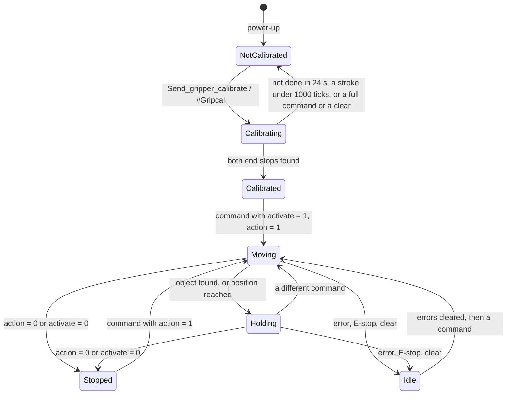
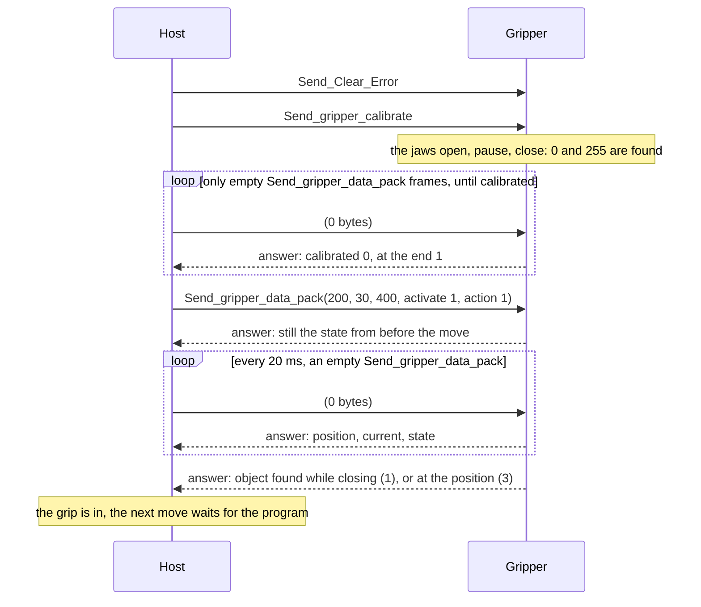

# How the gripper works

The gripper is a state machine in the driver's firmware, fed by one command and answering with one status. This
page is what it does with them.

## The states

**Not calibrated**

- After power-up the gripper does not know where its jaws are.
- It answers status requests and refuses moves.
- The gripper calibration is not kept over a power cycle.

**Calibrating**

- The jaws open at speed 40 and 500 mA until they have stood still against the end stop for half a second.
- The push then eases to a light 100 mA for a quarter of a second, so the jaws settle against the stop, and the
  end is read there.
- Then they close the same way.
- Position 0 (open) is set 32 encoder ticks inside the open stop, and 255 (closed) 16 ticks from the closed stop.
  A move to 0 or 255 therefore ends in free travel and does not press on the stop.
- The two ends must lie at least 1000 encoder ticks apart. If they do not, something jams the jaws, and the
  gripper stays uncalibrated.
- If the whole routine has not found both end stops within 24 seconds of its start, it gives up and the
  gripper stays uncalibrated.
- While it runs, send only empty Send_gripper_data_pack frames, the status poll. A full gripper command,
  Send_Clear_Error or an error ends the calibration. The gripper keeps the calibration it had before; after a
  power-up that is none.
- A new Send_gripper_calibrate always starts the routine from the beginning, also after one that was cut short.
- The calibration pushes with its own current. The driver's current limit (`#Ilim`, parameter 16) stays as it
  was.
- Send_gripper_calibrate has no answer; the calibrated bit of the status turns 1 when the routine is done.

**Moving**

- A command with the activate and action bits set starts a move towards the position, at the speed.
- The move does not start at full speed: it picks up speed over its first 0.1 s. Over the last stretch before
  the target it slows down, so the jaws arrive at the slowest speed.
- The current is limited to the commanded value. This is the gripper's own limit: the driver's current limit
  (`#Ilim`, parameter 16) stays as it is.
- The driver runs its velocity loop towards the target and watches two things: the speed of the jaws and the
  motor current.

**Holding**: the move ends in one of two ways.

- **Position reached** (within 5 encoder ticks): the driver switches to position control and holds the jaws
  there. Object detection reads 3.
- On arrival the velocity loop's integral is dropped. While the jaws stay within a quarter of a position step of
  the target (16 encoder ticks at most), the driver does not push them: friction holds them, and a few mA are
  left after a move. Pushed further off, the position loop pulls them back.
- A new command for the position where the jaws already rest, within that quarter step, is reached at once.
- **Object in the way**: the jaws stand still before the target, pushing with nearly the commanded current, for
  50 ms. The driver keeps pushing with the limited current, which is the grip. Object detection reads 1 if the
  jaws were closing, 2 if they were opening.
- Either way, nothing moves until a different command arrives.

**Stopped**

- A command with the action bit at 0, or with the activate bit at 0, stops the move.
- The driver keeps the jaws still: it runs its velocity loop at zero speed with the command's current limit, so
  the jaws resist being moved, and the object detection keeps reporting.
- The next command with the activate and action bits set moves the jaws again.

**Idle**

- An error, the E-stop bit, Send_Clear_Error, Send_Idle or `#Idle` takes the gripper to idle.
- The motor is no longer driven and holds nothing beyond the mechanism's friction, so an object can slip.
- After an error, clear it; then the next command with the action bit set moves the gripper again.

## The command

Send_gripper_data_pack carries, in 5 bytes:

| Field | Range | Meaning |
|---|---|---|
| Position | 0 to 255 | 0 fully open, 255 fully closed, linear over the stroke |
| Speed | 0 to 255 | 1.6 to 190 mm/s at each jaw, linear (500 to 60000 encoder ticks per second); see [Force and speed](../03-technical-data/force-and-speed.md) |
| Current | mA | the current limit of the move, so the grip force; clamped by the firmware only at 2800 mA |
| Activate | bit | 1 activates the gripper; 0 deactivates it: the move stops and the jaws are held still |
| Action | bit | 1 carries out the move; 0 stores the command and holds the jaws still where they are |
| E-stop | bit | 1 stops the gripper and raises the E-stop error, again at every cycle while the bit stays 1 |
| Release direction | bit | read by the firmware but not used |

The same command sent twice does nothing new: the driver compares every command with the previous one, and only
a changed command resets the "at position" state and starts a move.

So a host may repeat the command at any
rate, which the CAN watchdog needs; to move the jaws from a held position to the same position again, change
the speed or the current by one.

An empty Send_gripper_data_pack, 0 bytes, changes nothing and is answered like a full one: it is the status poll,
and it costs the bus almost nothing. A host usually sends one full command per move and polls with empty ones.

Over UART, `#Grippos` is the same command: it sets the position, activates the gripper, sets the action bit and
starts the move, with the speed and current last set by `#Gripvel` and `#Gripcur` (50 and 400 mA after power-up).

## The answer

Every Send_gripper_data_pack is answered with Respond_Gripper_data_pack, 4 bytes:

| Field | Meaning |
|---|---|
| Position | where the jaws are, 0 to 255, rounded to the nearest step |
| Current | the motor current, mA; positive while opening, negative while closing |
| Activated | the activate flag |
| Action status | the action bit of the last command, as received; it stays 1 while the gripper holds, and the calibration does not change it |
| Object detection | 0 moving, 1 object found while closing, 2 object found while opening, 3 at the position |
| Temperature error | the motor's thermistor is above the limit |
| Timeout error | the driver's CAN watchdog ran out |
| E-stop error | the E-stop bit was received |
| Calibrated | the gripper calibration is done |

The answer to a full command is sent before the gripper acts on that command, so it still carries the state from
before it; the answers to the polls that follow show the move. To follow a move, use the object detection: the
action status only repeats the bit you sent.

The bits are listed in [Errors and status bits](../reference/errors.md), with the byte layout in the
[CAN reference](../reference/can/gripper.md).

## A grip, message by message

What a host sends and what comes back, from power-up to a held object:

## Object detection, exactly

While a move is in progress and the jaws are not yet at the target, the driver reads *moving* (0) as long as the
jaws move faster than 500 encoder ticks per second, about 1.6 mm/s.

When they are slower than that and the motor
current is above 80 % of the commanded limit, something stops them. Once that has lasted 50 ms, the state reads
*object found*, 1 or 2 by the sign of the current. Below 80 % with the jaws slow, it still reads *moving*: the
object is soft and still being squeezed.

At the very start of a move the jaws are slow too. The 50 ms keep that from reading as an object, so a host
needs no pause before it trusts the state. Once the target is reached, 3, and it stays 3 until a different
command arrives.

The state is therefore a snapshot of each answer. A host that wants to know "did the grip succeed" sends the move,
then polls until the state is 1, 2 or 3, with a timeout of its own; the ROS 2 driver and the PAROL6 software do
exactly that.

## What the current limit does

The current limit of a move is the gripper's Iq limit for the duration of the move and the hold. It bounds the
torque, so the force on an object, and it also bounds how fast the jaws accelerate: a low limit with a high speed
gives a gentle, slow-starting move.

The driver's own current limit (`#Ilim`, parameter 16) applies only when the driver runs as a motor. Gripper
moves and the gripper calibration leave it as it is, so a Send_Save_config or `#Save` stores the limit you set.

The temperature of the motor is the other bound: holding an object at a high
current for minutes heats the windings, and at 75 °C the thermistor stops the gripper.

## Timing

The driver runs its loops at 6250 Hz; a move command takes effect at the next cycle, and the answer leaves within
a millisecond.

The CAN bus at 1 Mbit/s carries a command and its answer in well under half a millisecond, so a host
can run the gripper at several hundred commands per second; 50 Hz is a good rate for a controller that polls the
state.
