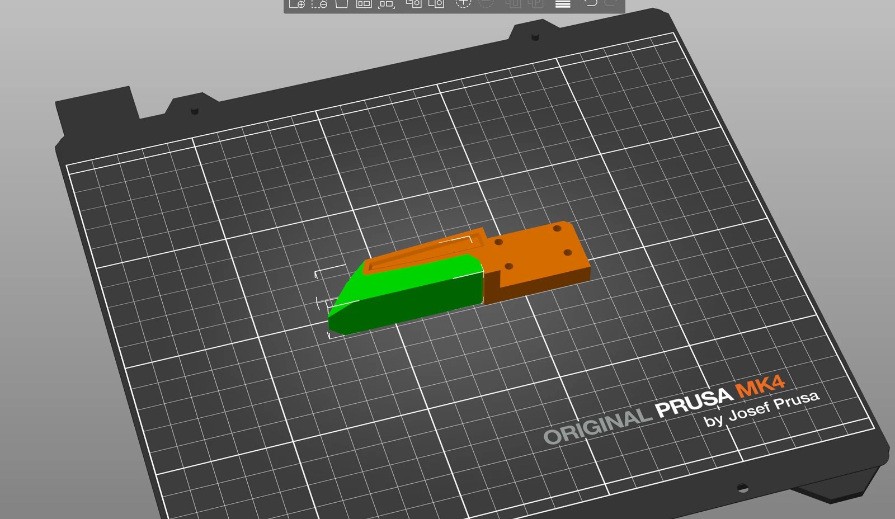
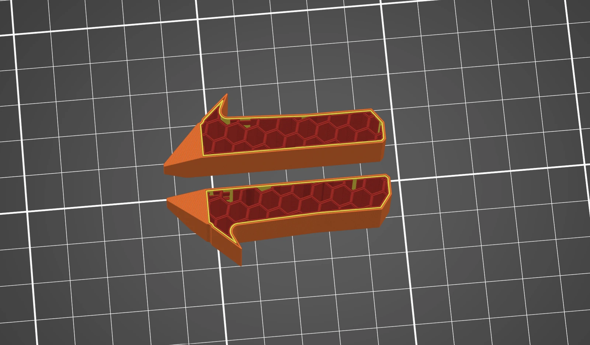

# Printing the parts

## Material and settings

PETG for every part but the TPU jaw pads. The repository's print table is one line, and it is the whole rule:
**use 25 % infill for all** ([Print_table.md](https://github.com/Source-Robotics/MSG-compliant-AI-stepper-gripper/blob/main/Print_table.md)).
Supports where your slicer asks for them; the body prints on its back.

## The files

| Variant | Folders in [STEP files](https://github.com/Source-Robotics/MSG-compliant-AI-stepper-gripper/tree/main/STEP%20files) |
|---|---|
| every gripper | [`Common parts`](https://github.com/Source-Robotics/MSG-compliant-AI-stepper-gripper/tree/main/STEP%20files/Common%20parts): the coupler plate and ring cover (or `ring_cover-PAROL6`), the camera mount and lid, the jaw blocker, the stepper spacer, the connector lid |
| your rail | [`Linear rail dependant parts`](https://github.com/Source-Robotics/MSG-compliant-AI-stepper-gripper/tree/main/STEP%20files/Linear%20rail%20dependant%20parts)`/<rail>`: the body and the two jaw carriers |
| your stepper | [`Stepper dependant parts`](https://github.com/Source-Robotics/MSG-compliant-AI-stepper-gripper/tree/main/STEP%20files/Stepper%20dependant%20parts)`/<stepper>`: the stepper cover, and the spacer for the 21.5 mm stepper |
| the jaws | [`Gripper jaws attachment`](https://github.com/Source-Robotics/MSG-compliant-AI-stepper-gripper/tree/main/STEP%20files/Gripper%20jaws%20attachment): one of the designs, mirrored for the other side |

The [Print files](https://github.com/Source-Robotics/MSG-compliant-AI-stepper-gripper/tree/main/Print%20files)
folder has the same parts as 3MF, ready to slice.

## The jaws

Two kinds, both in `Gripper jaws attachment`; mirror the file in the slicer for the other side:

- **TPU jaws** (recommended): a PETG body, `MSG_JAW_TPU_GLUE`, and a soft TPU pad printed separately and glued
  on. The pad deforms around the object for a gentler, surer grip. Print the pad with **16 % infill, no top or
  bottom layers and 2 walls** for the softest grip; the body with the normal settings.
- **Solid jaws**: `MSG_SOLID_JAW` in one piece, or `MSG_JAW_HOLLOW` for a two-colour print; `MSG_JAW_TPU_GLUE`
  prints solid too.

<figure markdown="span">
  { width="520" }
  { width="520" }
  <figcaption>Figure 16: The TPU jaw: the PETG body and the TPU pad as separate prints, and the pad's settings.</figcaption>
</figure>

Gluing the pad on, its orientation and the sponge tape for the gripping faces are in
[Jaws](../04-installation/jaws.md); the repository's
[jaw guide](https://github.com/Source-Robotics/MSG-compliant-AI-stepper-gripper/blob/main/Assembly%20manual/Building_gripper_jaws.md)
is the original.
