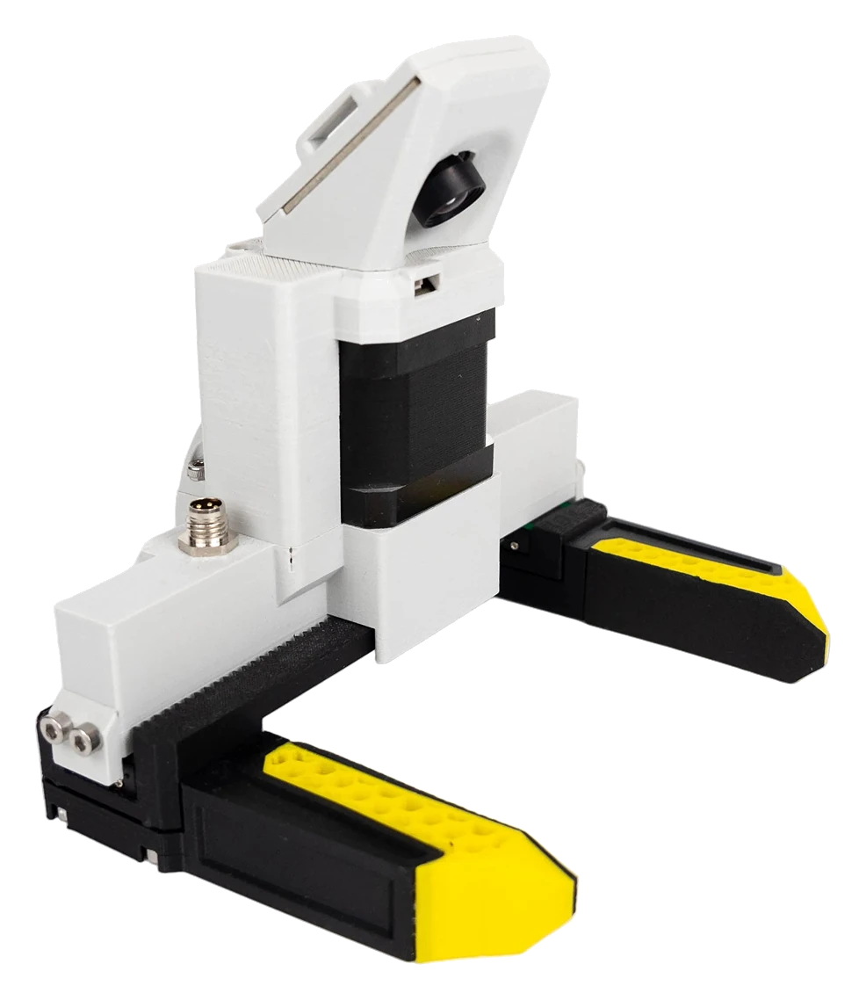

---
hide:
  - toc
comments: false
---

# MSG Gripper Manual

{ .hero }

<!-- doc-meta: msg -->

[First setup](05-setup/index.md){ .md-button .md-button--primary } [About this manual](about.md){ .md-button }

Source Robotics d.o.o. publishes this document for the MSG compliant AI stepper gripper. It is revised as the gripper and its
firmware change; the document number, the gripper release, the firmware, the revision and the date above identify
the version you are reading, and the document history on the About page says what changed. The version selector
in the header switches between gripper releases. The gripper runs the STEPFOC driver's firmware: take care that
the firmware named under *Applies to* matches what the gripper reports. The text and the images are licensed
CC BY-SA 4.0, the code examples MIT.

**The MSG is open source, and that is important to us.** Everything the gripper is made of is published: the
CAD and print files, the bill of materials, the assembly instructions, the driver's firmware and the software that
drives it. Buy the gripper assembled, or build one yourself; change the jaws or the body for your application and
fit it to any robot. The [build guide](build/index.md) is the order to do it in.

-   :material-play-circle:{ .lg .middle } **First setup**

    ---

    [Motor GUI](05-setup/motor-gui.md) in the browser, then [calibrate, activate, move](05-setup/first-moves.md):
    from the box to a gripper that opens and closes on command.

-   :material-book-open-variant:{ .lg .middle } **The manual**

    ---

    [Safety](02-safety.md), [Technical data](03-technical-data/index.md), [Installation](04-installation/index.md),
    [First setup](05-setup/index.md), [Operation](06-operation/index.md), [Maintenance](07-maintenance.md), [Firmware](08-firmware.md),
    [Troubleshooting](09-troubleshooting.md).

-   :material-robot-industrial:{ .lg .middle } **On a robot**

    ---

    [PAROL6 and PAR6](06-operation/robots.md), [ROS 2](06-operation/ros2.md), [Python](06-operation/python.md):
    the gripper from the robot's own software, from a ROS 2 node, or from your program over CAN.

-   :material-code-braces:{ .lg .middle } **API reference**

    ---

    The gripper's [CAN messages](reference/can/index.md) and [UART commands](reference/uart/index.md), the
    [status bits](reference/errors.md) and the [Python library](reference/python.md), read from the firmware.

-   :material-hammer-wrench:{ .lg .middle } **Open source: build your own**

    ---

    [The build guide](build/index.md): the repository's bill of materials, printing, the assembly, the driver's
    setup and the first run. The same manual applies.

