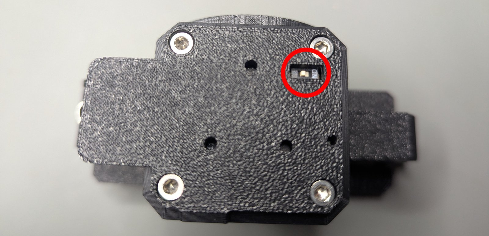
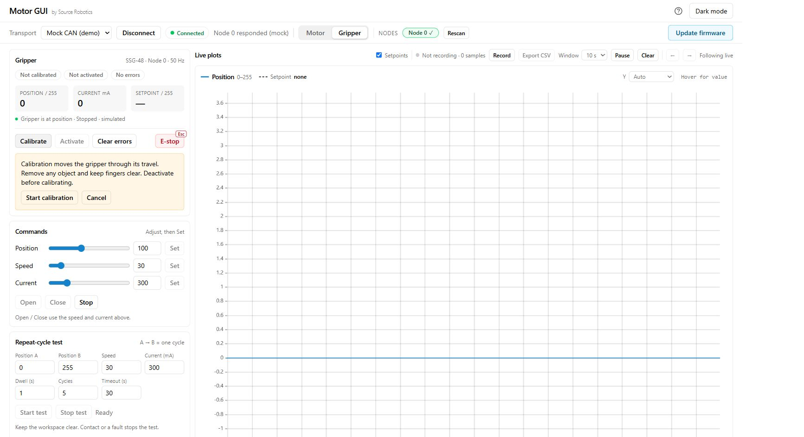
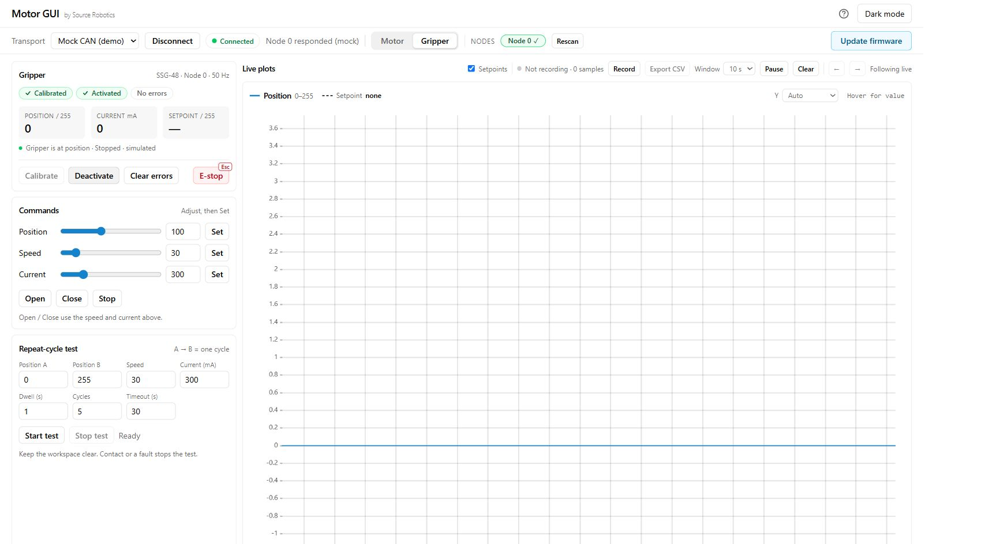

# Quick start

From an assembled MSG gripper to its first gentle open and close, using Motor GUI on a PC.
For a gripper already connected to a robot, use [On PAROL6 and PAR6](06-operation/robots.md).

!!! danger "Before connecting power"
    Keep fingers and loose objects out of the stroke. Calibration opens and closes the jaws fully. A wrong
    cable can reverse the supply or put 24 V on a CAN pin, and either destroys the driver: check the [numbered pinout](03-technical-data/connector.md#pin-numbers).

## 1. Choose your starting point

| Your gripper | Start here |
|---|---|
| Bought assembled | Its stepper is already calibrated and the driver configured. Continue below; the jaws still need calibration after each power-up. |
| Self-built, or a replacement driver or stepper | Finish [Driver setup and first run](build/first-run.md) first, then return here. Do not apply a factory preset to a bought gripper just to try this page. |
| No hardware yet | Open [Motor GUI](https://motorgui.com/), choose **Mock CAN (demo)** and **Connect**, then switch to **Gripper**. The demo is an SSG-48; the control panel is shared with MSG. |

## 2. Gather and mount

You need a mounted gripper with jaws/fingers fitted, a **24 V supply**, a correctly wired **M8 cable**, a
**CANvas USB-to-CAN adapter**, and Chrome or Edge.

1. Mount the gripper: [Mounting](04-installation/mounting.md).
2. Fit the jaws: [Jaws](04-installation/jaws.md).

!!! success "Check"
    The body cannot shift, the jaws travel freely, and the cable cannot enter their path.

More: the [What you need](01-overview/what-you-need.md) page lists the parts.

## 3. Wire with power off

1. Check the cable against [Connector and pinout](03-technical-data/connector.md): gripper pin 1 is CANL,
   pin 2 CANH, pin 3 +24 V, pin 4 GND.

     { width="520" }
     { width="520" }

2. Check continuity before the first power-up.
3. Connect the supply and the CANvas adapter as shown below.

    ```mermaid
    flowchart LR
        PC[PC USB] --> A[CANvas adapter]
        A -- CANH --> P2[Gripper pin 2: CANH]
        A -- CANL --> P1[Gripper pin 1: CANL]
        S[24 V supply] -- positive --> P3[Gripper pin 3: +24 V]
        S -- return --> P4[Gripper pin 4: GND]
    ```

4. Set the gripper's CAN termination ON for this two-node bench bus; the CANvas adapter provides the other end.

    { width="520" }

5. Leave the gripper at its shipped node ID, **0**, unless you already assigned another.

!!! success "Check, unpowered"
    The supply polarity and cable pinout match, and CANH-to-CANL measures about **60 Ω** with the bus connected.
    Otherwise check [The cable](04-installation/cable.md) and [CAN termination](04-installation/can-termination.md)
    before powering it.

## 4. Connect Motor GUI

1. Power the gripper.
2. Plug the CANvas adapter into USB.
3. Open [motorgui.com](https://motorgui.com/).
4. Choose **CAN (slcan)** at **1 Mbit/s**.
5. Press **Connect**, and choose the adapter's serial port.
6. Select node **0** (or your assigned ID).
7. Switch from **Motor** to **Gripper**.

!!! success "Check"
    Position and current feedback arrive. *Not calibrated* after power-up is normal. If feedback is missing,
    check the power, port, node ID and termination: [Troubleshooting](09-troubleshooting/index.md). If a fault
    disables the controls, resolve it using [Errors and recovery](06-operation/errors.md).

More: the [illustrated Motor GUI guide](05-setup/motor-gui.md) shows the panel.

## 5. Calibrate and activate

1. If the panel shows an error, press **Clear errors** first.
2. With the stroke empty and the gripper deactivated, press **Calibrate**.
3. Read the prompt, and press **Start calibration**.

    { width="700" }

4. Let the jaws find both end stops, and press nothing else until the panel says **Calibrated**: a move or a clear
   during the calibration ends it.
5. Press **Activate**, and check for faults.

!!! success "Check"
    The panel says **Calibrated**, **Activated**, and **No errors** before you command a move. A calibration
    that times out after 24 seconds has not found its end stops; do not continue as if it passed. Use
    [Calibration troubleshooting](09-troubleshooting/index.md#calibration).

More: [Calibrate, activate, move](05-setup/first-moves.md), the full procedure.

## 6. Make the first move

1. Set **Speed 30**, and apply it with its **Set** button.
2. Set **Current 300 mA**, and apply it with its **Set** button.
3. Press **Open**, then **Close**.
4. After that works, put a light test object between the jaws and repeat, keeping fingers clear.

{ width="700" }

The current limit sets an approximate force limit; [Force and speed](03-technical-data/force-and-speed.md)
explains the relationship and the motor's limits.

!!! success "Check"
    The position follows the command; on an object the jaws stop before fully closed and the panel reports an
    object. If it does not move, slips or reports an error, use [Troubleshooting](09-troubleshooting/index.md).

## 7. Finish and continue

Remove the test object before deactivating or switching off: the grip may release. Disconnect Motor GUI and
switch off the supply before changing cables.

| Next task | Guide |
|---|---|
| Control it from a program | [With Python](06-operation/python.md), [With ROS 2](06-operation/ros2.md) |
| Put it on a robot | [On PAROL6 and PAR6](06-operation/robots.md) |
| Inspect a CAN frame or download DBC definitions | [CAN frame tool and downloads](reference/can-tools.md) |
| Diagnose a problem | [Troubleshooting](09-troubleshooting/index.md), [Errors and recovery](06-operation/errors.md) |
